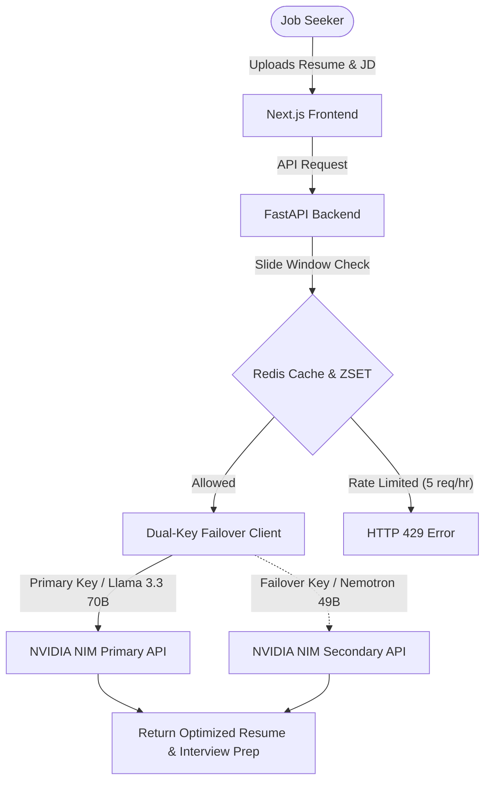

# 🚀 Best LinkedIn Auto Apply Bot & Chrome Extension (2026) — AI-First Job Search Copilot

[](LICENSE)
[](https://jobeasyapply.com)
[](https://jobeasyapply.com)

Applying to jobs on LinkedIn manually is a full-time job. Searching, reading descriptions, matching your skills, and filling out 50+ custom recruiter questions takes hours of active clicking.

JobEasyApply is an autonomous AI-first Job Search Copilot that works quietly in your browser, dynamically scoring jobs, writing context-aware AI answers, and auto-applying to LinkedIn Easy Apply positions while you sleep.

🔗 **Try it Free Forever (No Credit Card Required):** [jobeasyapply.com](https://jobeasyapply.com)

---

## 🛡️ Why Browser Session Automation Wins Over Cloud Bots
Most automated job search tools run on cloud servers (e.g., AWS or GCP) and log into your LinkedIn account on your behalf. This is the fastest way to get your account permanently restricted. LinkedIn tracks IP addresses, browser fingerprints, and hardware parameters.

JobEasyApply uses a **Secure Local Session Architecture**:
* **Residential IP:** It runs natively inside your own Chrome browser session using your own local IP.
* **Human-Like Pacing:** Injects micro-delays, scrolls the page naturally, and simulates mouse gestures.
* **Safe Autopilot:** It acts exactly like a highly efficient human assistant, keeping your account 100% secure.

---

## ⚔️ The Ultimate Comparison: JobEasyApply vs. The Rest
Here is an honest breakdown of how the leading automation tools stack up in 2026:

| Feature | JobEasyApply | LazyApply | Simplify.jobs | LoopCV |
| :--- | :--- | :--- | :--- | :--- |
| **Automation Level** | 100% Autopilot | 100% Autopilot | Semi-Auto (Autofill) | Automated Blaster |
| **AI Answer Quality** | Groq AI (Context-aware) | Simple Template | Simple Template | No custom answers |
| **Job Discovery** | AI-Scraped Shared Pool | Browser Scraping | Manual Browsing | Cloud scraping |
| **Resume Matching** | Vector Embeddings | Keyword Filter | None | Keyword Filter |
| **Safety Profile** | Local Browser Session | Browser Script | Local browser | Generic email blasts |
| **Free Plan** | Free Forever (5/day) | Limited Trial | Free (Autofill only) | Limited Trial |
| **Monthly Pricing** | $19/mo (Standard) | $24/mo (Premium) | $12/mo (Autofill only) | $19/mo (Paid) |

### 1. JobEasyApply vs. Simplify.jobs (Autofill vs. Autopilot)
* **Simplify** is a great form-filler. However, you still have to manually browse jobs, open each description, review the form, and click "Submit" 50 times.
* **JobEasyApply** runs on autopilot. It discovers open positions, matches them to your resume using vector embeddings, pre-queues them, writes tailored answers, and submits the applications — zero manual clicks required.

### 2. JobEasyApply vs. LazyApply (Template vs. Real AI)
* **LazyApply** uses static text templates to fill forms, resulting in repetitive, copy-paste answers that recruiters immediately spot.
* **JobEasyApply** integrates a Groq AI context layer that dynamically reads the recruiter's questions, cross-references your parsed resume, and writes a unique, tailored response per application.

---

## 🧠 Smart AI Form-Filling in Action
When a job application throws a custom recruiter question like:
> *"How many years of experience do you have leading React Native teams, and what is your notice period?"*

Our Groq AI checks your resume, parses your work history, and answers intelligently:
> *"I have 3 years of React Native leadership experience from my role at TechCorp and am available immediately."*

It safely handles:
* **Numeric Inputs:** Automatically sanitizes and extracts digits.
* **Radio and Select Groups:** Intelligently maps choices like Yes/No, Work Authorization, Demographics, and Relocation preferences.
* **Safety Fallbacks:** Bypasses required fields with safe, profile-backed defaults.

---

## 🚀 Get Started in 3 Simple Steps
1. **Sign Up for Free:** Create a free account at [jobeasyapply.com](https://jobeasyapply.com) (no credit card required).
2. **Upload Your Resume:** Upload your resume, set your desired job titles, locations, and preferences.
3. **Run the Extension:** Open the extension and click "Auto Apply" to start submitting high-matching applications automatically.

---

## 🏗️ Technical Architecture & Case Study

### How We Run 8 AI Tools for $0/Month
Free LLM utilities are great for user acquisition, but high traffic can break a developer's budget. To run our suite of 8 optimization tools for free, we use **NVIDIA NIM** (NVIDIA Inference Microservices) developer APIs, backed by a dual-key failover client and strict atomic rate-limiting.



### 1. Dual-Key Failover Client (Python / FastAPI)
To ensure high availability and prevent rate-limit blockages, our FastAPI backend implements a dual-key + multi-model failover client:

```python
import logging
from openai import OpenAI

NVIDIA_BASE_URL = "https://integrate.api.nvidia.com/v1"
NVIDIA_MODELS = [
    "meta/llama-3.3-70b-instruct",
    "nvidia/llama-3.3-nemotron-super-49b-v1"
]

def call_nvidia(system_prompt: str, user_prompt: str, api_keys: list):
    """
    Call NVIDIA NIM with dual-key + multi-model failover.
    """
    for model in NVIDIA_MODELS:
        for key in api_keys:
            try:
                client = OpenAI(base_url=NVIDIA_BASE_URL, api_key=key)
                response = client.chat.completions.create(
                    model=model,
                    messages=[
                        {"role": "system", "content": system_prompt},
                        {"role": "user", "content": user_prompt}
                    ],
                    temperature=0.15,
                    max_tokens=2048
                )
                return response.choices[0].message.content
            except Exception as e:
                logging.error(f"NVIDIA Model {model} failed: {e}")
                continue
    return None
```

### 2. Atomic Sliding Window Rate Limiting (Redis + Lua)
To protect our developer API keys from scrapers and bots, we enforce a strict rolling rate limit of **5 requests per hour per IP address**. We use a Redis sorted set (`ZSET`) and run a Lua script atomically to prevent race conditions:

```lua
-- Redis Lua script for sliding window rate limiting
local key          = KEYS[1]
local window_start = tonumber(ARGV[1])
local now          = tonumber(ARGV[2])
local limit        = tonumber(ARGV[3])
local window       = tonumber(ARGV[4])

-- Remove requests older than the sliding window boundary
redis.call('ZREMRANGEBYSCORE', key, 0, window_start)

-- Check the current count of requests in the window
local count = redis.call('ZCARD', key)
if count >= limit then
    return 0 -- Deny request (Rate limit exceeded)
end

-- Record the new request timestamp
redis.call('ZADD', key, now, tostring(now))
redis.call('EXPIRE', key, window)
return 1 -- Allow request
```

---

## 💰 The Bootstrapped Developer Stack ($0/Month)

| Service | Role | Cost / Month |
| :--- | :--- | :--- |
| **NVIDIA NIM** | Llama 3.3 70B & Nemotron 49B Inference (Resume parser & ATS optimizer) | **$0.00** (Developer Quota) |
| **Vercel** | Static hosting & CDN for the Next.js Frontend | **$0.00** (Free Tier) |
| **Oracle Cloud**| Backend Host (FastAPI, Postgres database, Redis cache) | **$0.00** (Always Free Tier) |
| **GitHub Actions**| CI/CD Pipeline | **$0.00** (Free Plan) |
| **Total** | **Running a global AI career platform serving 50k+ pageviews/mo** | **$0.00** |

---

## 🛠️ Getting Started (Local Development)

### Prerequisites
- Python 3.11+
- Node.js 18+
- Docker & Docker Compose

### Step 1: Start Infrastructure
Run the local database, cache, and object storage:
```bash
docker compose up -d
```

### Step 2: Spin Up the FastAPI Backend
```bash
cd apps/backend
pip install -r requirements.txt
alembic upgrade head
uvicorn main:app --reload --port 8000
```
*API documentation will be available at [http://localhost:8000/docs](http://localhost:8000/docs).*

### Step 3: Run the Next.js Frontend
```bash
cd apps/frontend
npm install
npm run dev
```
*The client app runs locally at [http://localhost:3000](http://localhost:3000).*

### Step 4: Run Celery Workers
Start the background worker tasks for job application queue management:
```bash
celery -A workers.celery_app worker --loglevel=info
```

---

## 📁 Repository Structure

```text
autoJobsApply/
├── apps/
│   ├── backend/          # FastAPI (Python 3.11)
│   └── frontend/         # Next.js 16 (TypeScript / CSS Modules)
├── workers/              # Celery task runners for auto-applying
├── migrations/           # Alembic database migrations
├── docker/               # Docker configuration files
└── docker-compose.yml    # Development stack orchestrator
```

---

## 🔒 Security & Safe Automation
Unlike spammy mass-appliers that risk your account status, JobEasyApply is designed with safety first:
* **Local Browser Injection:** Submissions occur directly in your own browser instance, matching your standard residential IP and active session cookies.
* **Human-like Pacing:** Features randomized delays between fields and steps to match standard human interaction patterns.
* **No Database Storage of Credentials:** Your passwords and LinkedIn access credentials never touch cloud databases.

---

## 📄 License
This project is open-source and available under the MIT License. For commercial usage or custom integrations, please check the [JobEasyApply Website](https://jobeasyapply.com).
